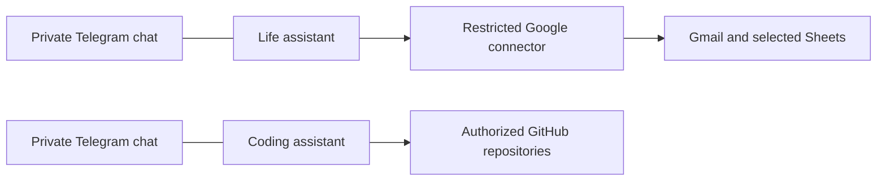

# Hermes Assistants

A personal deployment of [Hermes Agent](https://github.com/NousResearch/hermes-agent) with two separate Telegram assistants. One handles personal follow-ups; the other works on code you explicitly ask it to change.

[Local setup](docs/LOCAL-SETUP.md) · [Railway guide](deploy/railway/README.md) · [Validation](docs/VALIDATION.md) · [Contributing](CONTRIBUTING.md)

| Assistant | What it does |
| --- | --- |
| **Life** | Reviews recent Gmail and selected Google Sheets through a restricted connector. It can prepare drafts for review, but cannot send mail. A fresh installation can add scheduled checks and digests, paused by default. |
| **Coding** | Works in authorized repositories on demand. Changes go to a draft pull request for review rather than straight to `main`. It has no access to the Google connector. |

The agents have separate networks, provider logins and persistent state. The connector keeps Google credentials outside both agents. This repository contains the deployment code and docs, not the private account state. See the [data-use notice](docs/PRIVACY.md) for what the life assistant processes.

## Get started

- **Fresh local installation:** Follow the [Docker Compose setup](docs/LOCAL-SETUP.md) to initialize both roles, configure your own bots and verify access before enabling schedules.
- **Hosted installation:** Use the [Railway guide](deploy/railway/README.md) for service configuration, persistent volumes, migration and recovery.
- **Working on the repository:** See the [contributor guide](CONTRIBUTING.md) for the file layout, offline checks and review process.

> [!WARNING]
> Do not start local gateways or run local `chat` or `login` commands while a hosted installation is using the same bot tokens or provider grants.

## Repository layout

| Location | Contents |
| --- | --- |
| [`hermesctl`](hermesctl), [`compose.yaml`](compose.yaml) | Local setup and service management |
| [`config/`](config/), [`skills/`](skills/) | Role configuration, instructions and skills |
| [`google/`](google/), [`plugins/restricted-google/`](plugins/restricted-google/) | Restricted Google connector and Hermes tool integration |
| [`deploy/railway/`](deploy/railway/) | Railway images and deployment guide |
| [`docs/`](docs/) | [Local setup](docs/LOCAL-SETUP.md), [use](docs/USE.md), [validation](docs/VALIDATION.md) and [privacy](docs/PRIVACY.md) |
